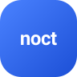
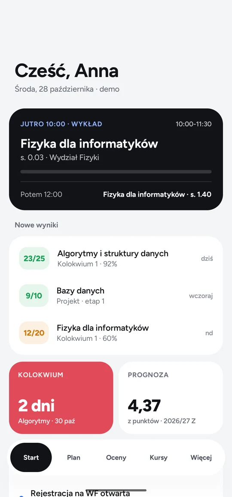
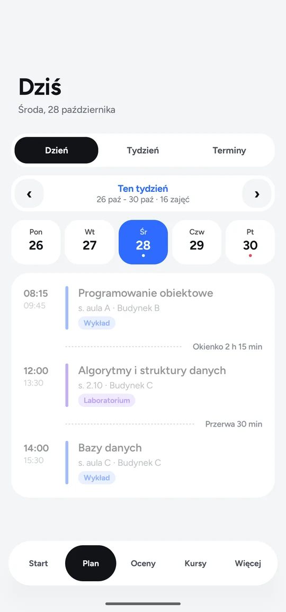
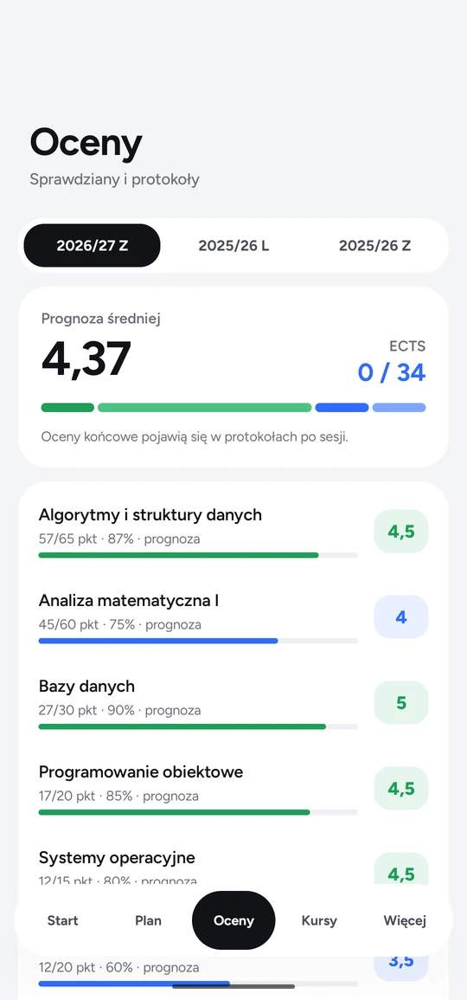
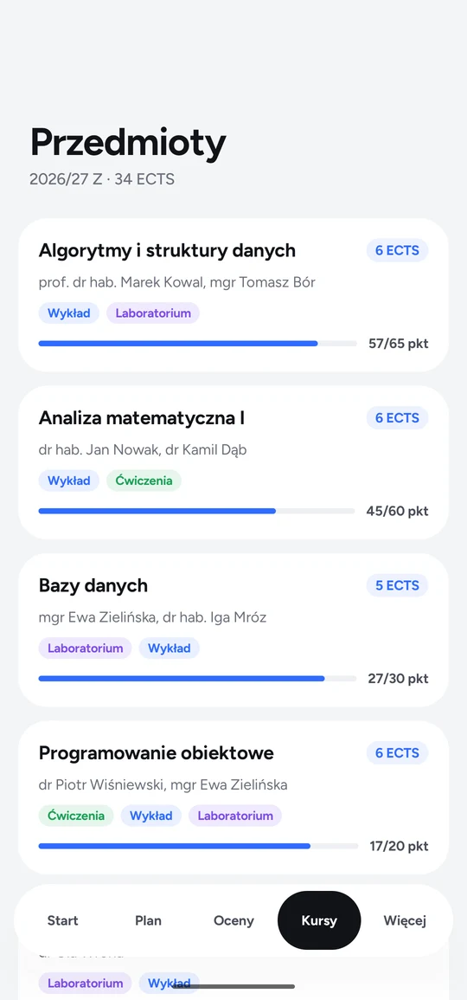

<div align="center">



# Noct Dzienniczek

**Plan zajęć, punkty, oceny i prognoza średniej. Prosto z USOS, na Androida.**


[](LICENSE)

[Funkcje](#funkcje) · [Bezpieczeństwo](#bezpieczeństwo) · [Klucz USOS API](#klucz-usos-api) · [Budowanie](#budowanie)

</div>

<br>

<table>
  <tr>
    <td></td>
    <td></td>
    <td></td>
    <td></td>
  </tr>
  <tr>
    <td align="center"><b>Start</b><br><sub>najbliższe zajęcia i nowe wyniki</sub></td>
    <td align="center"><b>Plan</b><br><sub>dzień, tydzień, terminy</sub></td>
    <td align="center"><b>Oceny</b><br><sub>prognoza średniej i ECTS</sub></td>
    <td align="center"><b>Przedmioty</b><br><sub>prowadzący i punkty</sub></td>
  </tr>
</table>

## Czym jest Noct Dzienniczek

Dziennik studenta, który zbiera w jednym miejscu to, co w USOS jest rozrzucone po kilku stronach: plan zajęć, punkty ze sprawdzianów, oceny i ECTS. Do tego liczy prognozę średniej z bieżących punktów i przypomina o kolokwiach.

Działa z każdą uczelnią, która udostępnia USOS API (UW, UJ, PW, PWr, UAM, UMK, UŁ, UWr, SGH, Vistula i inne). Bez klucza można obejrzeć aplikację na danych demo.

## Funkcje

- **Start:** najbliższe zajęcia z odliczaniem, nowe wyniki, najbliższe kolokwium i prognoza średniej.
- **Plan:** widok dnia i tygodnia, okienka i przerwy, terminy egzaminów.
- **Oceny:** prognoza z punktów z własnymi progami, ECTS, oceny z poprzednich semestrów.
- **Przedmioty:** prowadzący, typy zajęć i postęp punktów.
- **Grupa roku:** wspólne terminy kolokwiów dla całego roku na kod zaproszenia.
- **Przypomnienia** o zajęciach i egzaminach oraz **5 widżetów** na ekran główny (teraz, tydzień, wynik, egzamin, prognoza).
- mLegitymacja, profil, jasny i ciemny motyw.

## Bezpieczeństwo

- **Logowanie przez stronę uczelni (OAuth 1.0a).** Aplikacja nie widzi hasła do USOS.
- **Powrót z logowania jest sprawdzany:** aplikacja przyjmuje tylko link z tym samym tokenem, który sama wysłała, więc obca strona ani aplikacja nie podsunie jej cudzego logowania.
- **Tokeny nie trafiają do kopii w chmurze Google** ani do przenoszenia na nowy telefon (`allowBackup=false`, reguły w `res/xml/data_rules.xml`).
- **Reguły Firestore** ([`firestore.rules`](firestore.rules)): każdy widzi tylko swój dokument. W grupie roku terminy widzą tylko członkowie, autor wpisu nie da się podmienić, usunąć termin może tylko osoba, która go dodała, a pola mają limity długości.
- Reguły mają testy na emulatorze Firestore: [`firebase-tests/rules.test.mjs`](firebase-tests/rules.test.mjs).
- **Kody grup** mają 8 losowych znaków z 32 (`SecureRandom`), czyli ponad bilion kombinacji. Grup nie da się wylistować.

## Klucz USOS API

Każda uczelnia wydaje własny klucz aplikacji pod adresem `https://<usosapps-uczelni>/developers/` (np. https://usosapps.uw.edu.pl/developers/). Klucz wpisuje się na ekranie logowania (pole „Klucz aplikacji USOS API”) albo w `local.properties` przed budowaniem:

```properties
usos.consumerKey=...
usos.consumerSecret=...
```

`local.properties` nie trafia do repozytorium.

## Co pobiera z USOS

| Endpoint | Ekran |
|---|---|
| `users/user` | profil |
| `courses/user`, `courses/courses` | przedmioty, ECTS |
| `tt/user`, `tt/classgroup_dates2` | plan, kolejne terminy, egzaminy |
| `crstests/participant`, `crstests/node`, `crstests/user_points` | punkty, nowe wyniki, prognoza |
| `grades/terms2` | oceny z poprzednich semestrów |
| `users/users` | prowadzący |
| `cards/user` | mLegitymacja |

## Budowanie

Potrzebne: JDK 17 i Android SDK (ścieżka w `local.properties`: `sdk.dir=...`).

```bash
./gradlew assembleRelease
```

APK: `app/build/outputs/apk/release/app-release.apk`.

Firebase (grupa roku i kopia ustawień) włącza się, gdy w `app/` leży `google-services.json` z własnego projektu Firebase z logowaniem anonimowym. Bez tego pliku aplikacja działa w pełni lokalnie. Reguły wdraża się poleceniem `firebase deploy --only firestore:rules`.

## Technologie

Kotlin, Jetpack Compose, Glance (widżety), WorkManager (przypomnienia), Firebase Auth i Firestore, USOS API z podpisem OAuth 1.0a (HMAC-SHA1) napisanym od zera.

## Licencja

[MIT](LICENSE) © 2026 [xwolter](https://github.com/xwolter)
